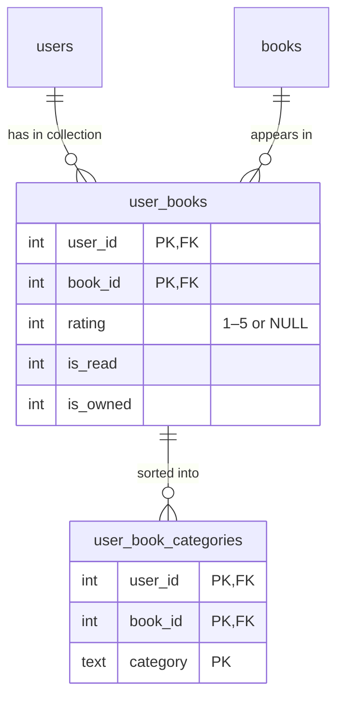

# Development

Requires Python ≥ 3.12 and [uv](https://docs.astral.sh/uv/). See [CONTRIBUTING.md](../CONTRIBUTING.md) for how to submit changes.

## Running locally

Set up once:

```sh
uv sync
uv run pybabel compile -d src/mylittlebooklist/translations   # builds the .mo files
```

Then start the app from the repository root:

```sh
export ADMIN_PASSWORD=admin                            # PowerShell: $env:ADMIN_PASSWORD = "admin"
uv run flask --app mylittlebooklist.app run --debug
```

Open http://127.0.0.1:5000 and log in as `admin` with the password you set.

- The database is `books.db` in the current directory. Set `DB_PATH` to use another file, such as `demo.db`, to keep test data separate from your library. A relative path is resolved against the current directory: if you start from another folder, the app creates a new, empty database there.
- `ADMIN_PASSWORD` is only used when the database is created. Without it, the app generates a password and prints it to the log once.
- A local start does not read `.env`, which is only used by Docker. Set the variables in the terminal as shown above.

## Demo data

To fill the local database with the [demo data](../README.md#demo-data-optional), run this in the same terminal, so it uses the same settings and database:

```sh
uv run python -m mylittlebooklist.demo
```

On a new database, the loader already creates the admin account, so set `ADMIN_PASSWORD` first. The demo books are defined in `DEMO_BOOKS` in `src/mylittlebooklist/demo.py`.

## Checks

```sh
uv run pytest
uv run ruff check . && uv run ruff format --check .       # lint and formatting
uv run mypy .                                             # type check
uv run bandit -r src                                      # security scan
uv run pip-audit                                          # known vulnerabilities in dependencies
```

## Project layout

```text
src/mylittlebooklist/
  app.py          Flask app and its configuration, loads the routes, sets up the database
  database.py     SQLite connection, schema setup and migrations
  openlibrary.py  ISBN helpers and Open Library lookup
  demo.py         optional demo data loader
  schema.sql      database schema (created automatically on start)
  routes/         auth.py (login, CSRF, account), books.py (gallery, collection), export.py (CSV, Excel, index cards), users.py (admin)
  templates/      Jinja templates
  static/         CSS and logo
  translations/   translation template (messages.pot) and catalogs per language (messages.po)
tests/            tests, one file per topic
babel.cfg         extraction config for pybabel
```

## Database



The full definition is in `src/mylittlebooklist/schema.sql`.

- `books` is a shared catalog: each book exists once, and its data and cover apply to all users.
- `user_books` holds what is personal: a user's collection, rating and flags.
- `user_book_categories` holds a user's categories per book. A book can be in several categories, and a category exists as long as one of the user's books uses it.
- When the last user removes a book, or the last user who has it is deleted, the book and its cover are deleted too (`remove_orphans()` in `database.py`).
- `PRAGMA user_version` stores the schema version (see [Changing the database schema](#changing-the-database-schema)).

## Changing the database schema

Existing databases are updated automatically on start. For a schema change:

1. Append the SQL to `MIGRATIONS` in `src/mylittlebooklist/database.py` (one entry per step, never edit or reorder existing entries).
2. Make the same change in `src/mylittlebooklist/schema.sql`, so new databases start in the final state.

Before migrating, the app saves a backup next to the database (`books.db.v<version>.bak`). Each step runs in its own transaction: if one fails, it is rolled back and the app does not start. An older app version refuses to start on a database that was already migrated by a newer one. To go back, restore the backup.

## Translating

UI texts are written in English and marked with `_("…")` in the Python modules and the templates. The language is picked from the browser's `Accept-Language` header; English is the fallback. Every language folder in `src/mylittlebooklist/translations/` is picked up automatically – no code change needed.

```sh
uv run pybabel extract -F babel.cfg --add-location=file --project="My Little Booklist" -o src/mylittlebooklist/translations/messages.pot src/mylittlebooklist   # after changing texts
uv run pybabel update -i src/mylittlebooklist/translations/messages.pot -d src/mylittlebooklist/translations       # merge new texts into all languages
uv run pybabel init -i src/mylittlebooklist/translations/messages.pot -d src/mylittlebooklist/translations -l eo   # new language, e.g. eo = Esperanto
uv run pybabel compile -d src/mylittlebooklist/translations   # build the .mo files
```

Then translate the entries in `src/mylittlebooklist/translations/<lang>/LC_MESSAGES/messages.po`. The compiled `.mo` files are not committed. They are compiled by Docker build.
